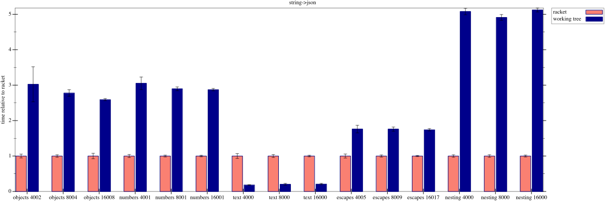

# parser-combinator

Simple Racket parser library, and default (tested) JSON implementation.

Read the [documentation](https://nixpulvis.com/parser-combinator/).

## Install

```sh
raco pkg install parser-combinator
```

## Parser Usage

```racket
#lang racket
(require parser-combinator/parse)

(define-parser GREETING
  (seq list (lit "hello ") (alt (lit "world") (lit "racket"))))

(parse GREETING "hello world")
;=> '("hello " "world")
(apply string-append (parse GREETING "hello racket"))
;=> "hello racket"
```

The [Quick Start](https://nixpulvis.com/parser-combinator/quick.html) has a
longer example. Otherwise, you can read the JSON parser's implementation as
well.

## JSON Usage

```racket
#lang racket
(require parser-combinator/json)

(string->json "[]")
;=> '()
(string->json "{}")
;=> '#hasheq()
(string->json "[1, {\"foo\": false}, 2]")
;=> '(1 #hasheq((foo . #f)) 2)
```

## Docs

Building the manual requires `scribble-lib` (provides `raco scribble`) and
`racket-doc` (the Racket docs the manual links into). Both ship with the full
Racket distribution. On a minimal install, install them first.

```sh
raco pkg install --auto --skip-installed scribble-lib racket-doc
```

Build the manual into `_site/`.

```sh
scripts/doc.sh
```

## Tests

The tests require `compiler-lib` (provides `raco test`) and `rackunit-lib`.
Both ship with the full Racket distribution. On a minimal install (e.g.
Homebrew's `minimal-racket`), install them first.

```sh
raco pkg install --auto --skip-installed compiler-lib rackunit-lib
```

Run all of the tests.

```sh
raco test tests
```

The JSON tests also parse the real-world JSON files in `tests/fixtures`, and
check that `string->json` agrees with Racket's own parser, `string->jsexpr`.
They're `canada.json` (GeoJSON, mostly numbers), `citm_catalog.json` (objects
and short strings), and `twitter.json` (non-ASCII text), from
[nativejson-benchmark](https://github.com/miloyip/nativejson-benchmark), under
its MIT license in `tests/fixtures/LICENSE`.

## Benchmarks

`scripts/bench.rkt` times `string->json`, at git refs against each other and
against Racket's own parser. It requires the
[`benchmark`](https://pkgs.racket-lang.org/package/benchmark) package, which
isn't a dependency of this package. The comment at the top of the script
documents its options.

```sh
raco pkg install --auto --skip-installed benchmark
scripts/bench.rkt
```

On `master` as of 2026-10-22, against Racket's parser.

```sh
scripts/bench.rkt --racket --vs racket --plot assets/bench-racket-2026-10-22.svg
```


